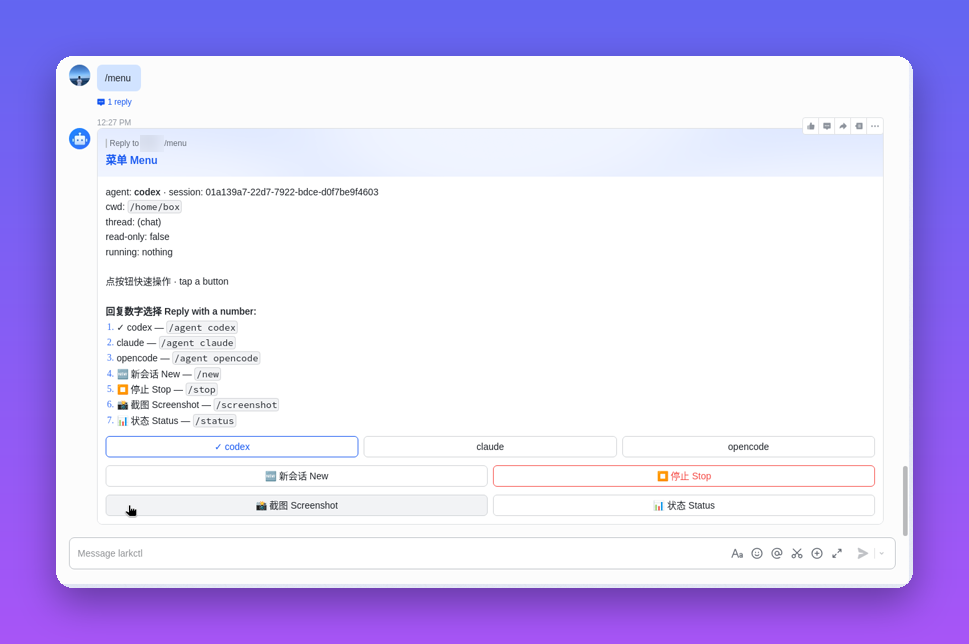
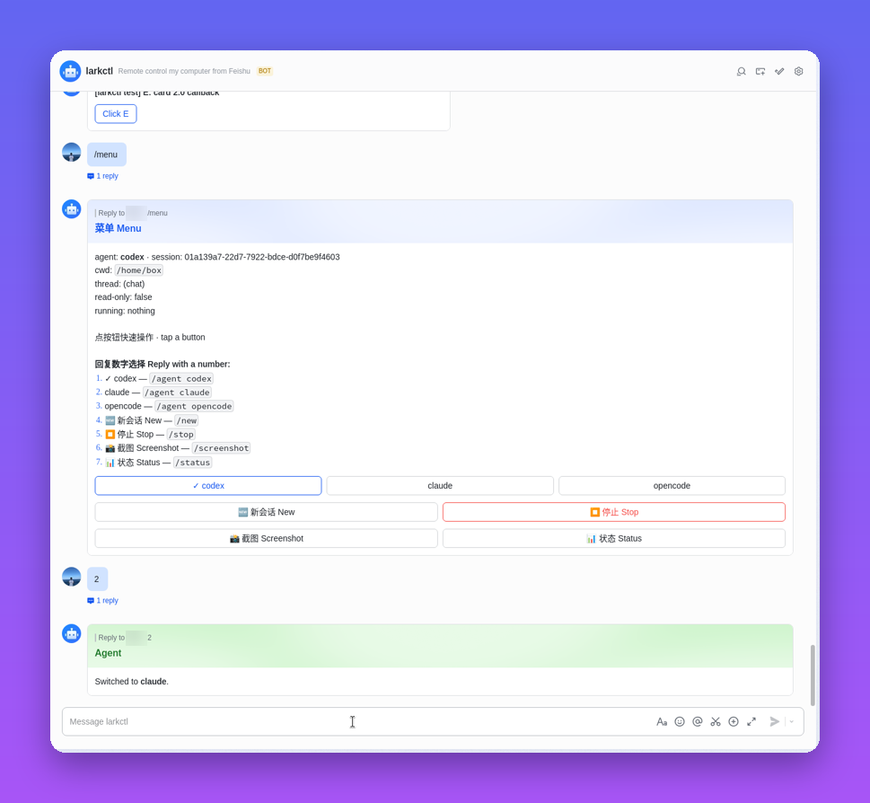
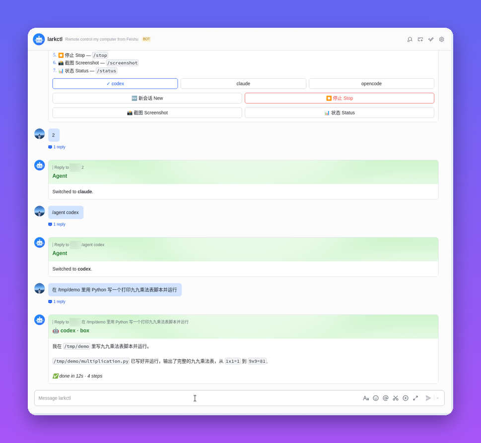
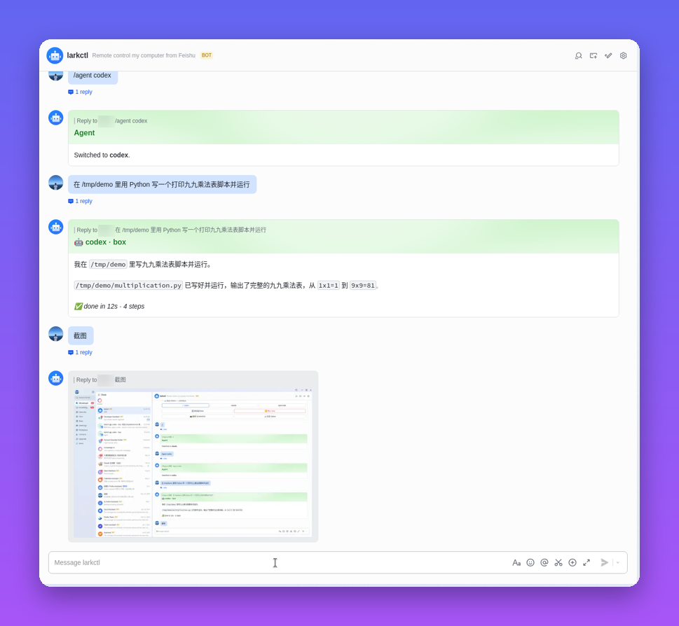
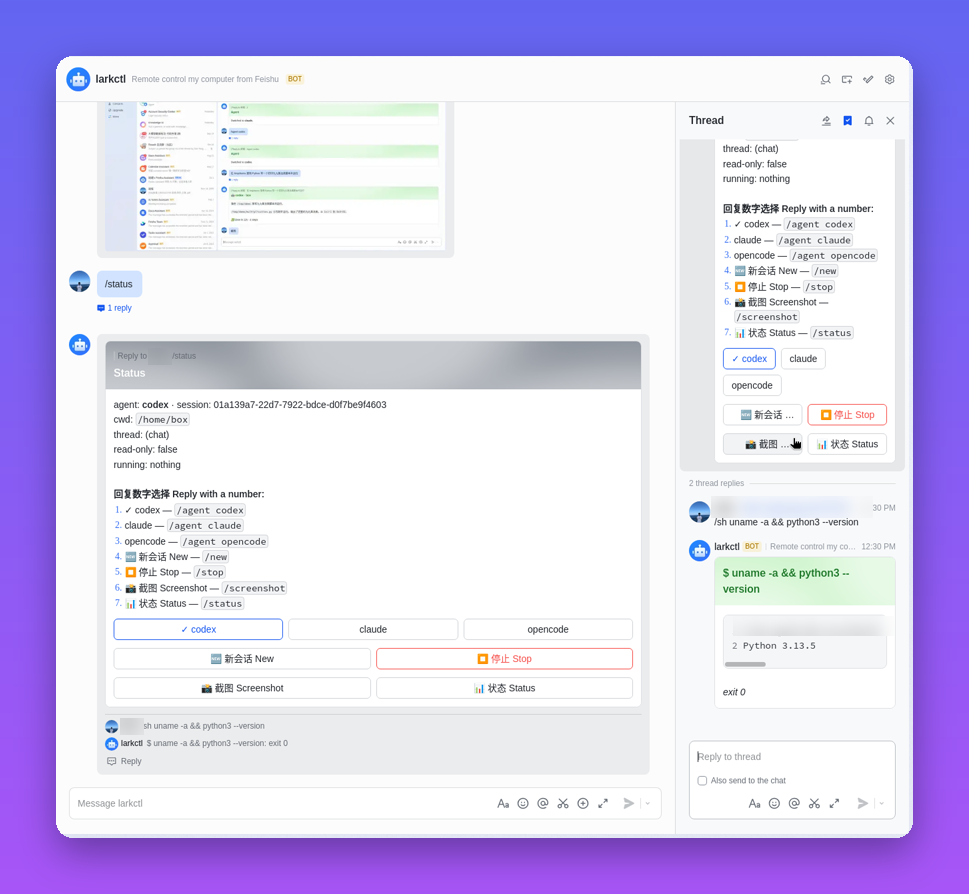
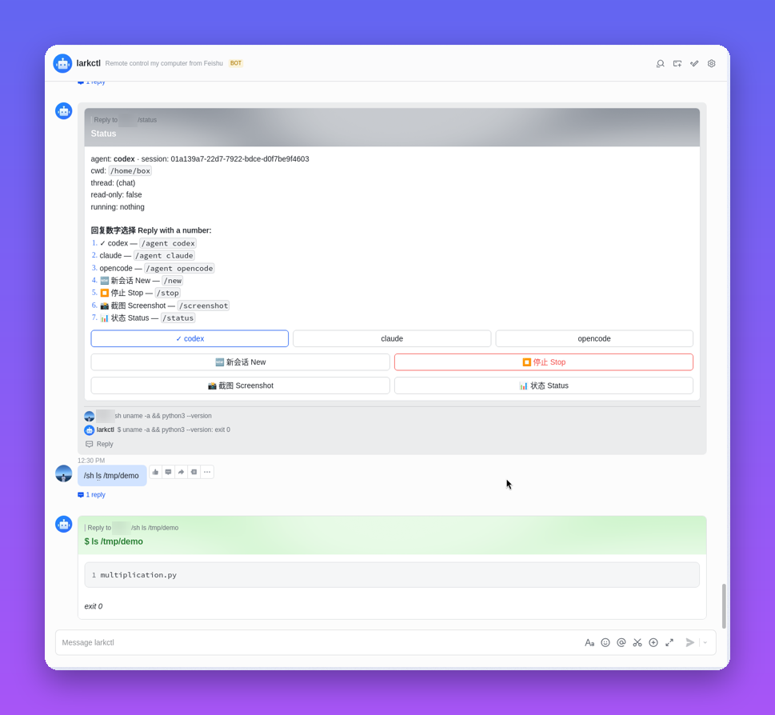
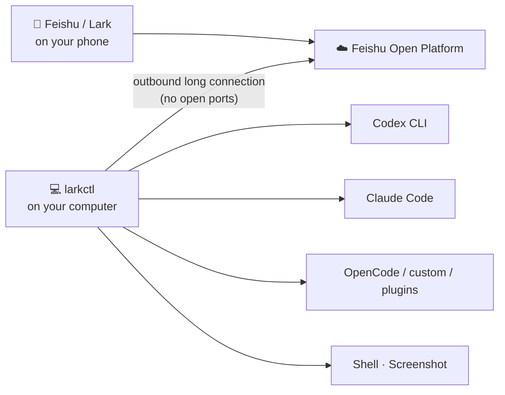
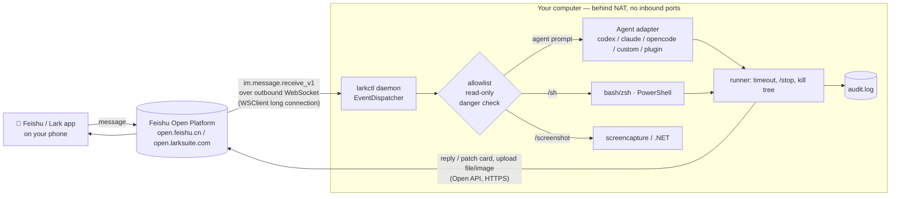

<h1 align="center">🛰️ larkctl</h1>
<p align="center"><b>Your code is at home. You're not. Send a message in Feishu / Lark — your computer does the rest.</b></p>

<p align="center">
  <a href="https://github.com/hucheng91/larkctl/actions/workflows/ci.yml"></a>
  <a href="LICENSE"></a>
  = 18.17">
  
  
</p>

<p align="center"><a href="README.zh-CN.md">中文文档</a> · <a href="#-quick-start">Quick start</a> · <a href="#commands">Commands</a> · <a href="#security">Security</a> · <a href="#-faq">FAQ</a></p>

---

### 🚇 You're on the subway, and it suddenly hits you…

…the agent you left running on your home computer probably finished an hour ago. Or it's stuck on a question. Or you just had the perfect idea for that bug fix. Your laptop is at home; all you have is your phone.

### 😩 Getting back to your own computer is a network problem

Your machine sits behind a home router or office firewall (NAT). To reach it you need a public IP, port forwarding, a VPN or a tunnel (frp, ngrok, Tailscale…) to set up and keep alive, and links to overseas services from mainland China often drop out. All that just to type one line into a terminal.

### 💡 With larkctl, you just send a message in Feishu

Feishu / Lark is already on your phone and works on any network. larkctl runs on your computer and opens an **outbound long connection** to Feishu, so there are no ports to open, no public IP and no tunnel. DM your bot "fix the failing test in web" and your local Codex / Claude Code / OpenCode gets to work, posting live progress back to the chat.

| | Traditional remote access | **larkctl** |
|---|---|---|
| Network setup | Public IP, port forwarding, VPN or tunnel (frp / ngrok / Tailscale) | **None** — outbound long connection only |
| Exposed ports | SSH / RDP / VNC open to the internet | **Zero** inbound ports |
| On your phone | Tiny terminal or remote desktop, fiddly typing | **A chat**: tap buttons, type a sentence, or speak |
| Flaky networks | Session drops, reconnect, start over | Feishu delivers messages; the job keeps running on your computer |
| Several tasks | Juggle terminal tabs and tmux | **One thread (话题) = one task**, running in parallel |
| See what's happening | Scroll logs | Live progress cards, screenshots on demand |
| Safety | Whoever gets in has a full shell | Allowlist, confirm dangerous commands, read-only mode, audit log |

<p align="center">
  <a href="docs/demo.mp4"></a><br/>
  <sub>▶️ <a href="docs/demo.mp4">Watch the 45-second demo with voiceover (MP4, Mandarin)</a></sub>
</p>

## ☕ A day with larkctl

<table>
<tr><td width="46%"></td><td>

**08:40 · On the subway: "what’s my computer doing?"**

Send `/menu`. One card shows your agent, project and session, with buttons for everything. No buttons on your Feishu edition? Just reply with a number.

</td></tr>
<tr><td width="46%"></td><td>

**08:45 · "Let’s use Claude for this one."**

Tap **claude** (or reply `2`). The next message goes to Claude Code, and each agent keeps its own session.

</td></tr>
<tr><td width="46%"></td><td>

**09:10 · At a cafe: one sentence, real code**

"在 /tmp/demo 里用 Python 写一个打印九九乘法表的脚本并运行" ("write a Python script in /tmp/demo that prints the multiplication table, and run it"). The agent writes the file on *your* computer, runs it and reports back: done in 12 s.

</td></tr>
<tr><td width="46%"></td><td>

**12:30 · "Did it really work?"**

Type `截图` ("screenshot"). A screenshot of your desktop comes straight back into the chat.

</td></tr>
<tr><td width="46%"></td><td>

**15:00 · Two things at once**

Start a thread (话题) for each task. Every thread has its own agent, project and session, so they run in parallel without stepping on each other.

</td></tr>
<tr><td width="46%"></td><td>

**18:20 · On the train home: one quick command**

`/sh ls /tmp/demo` or `!git status` runs a shell command in your project and returns the output. Dangerous commands ask for confirmation first.

</td></tr>
</table>

## ✨ What you get

| | | |
|---|---|---|
| 🤖 **Pluggable coding agents**<br/>Codex, Claude Code, OpenCode, custom command agents, npm/JS plugins | 💬 **One sentence → code**<br/>Plain text goes to the agent; progress streams into a live-updating card | 🧵 **Threads run in parallel**<br/>Each Feishu thread (话题) has its own agent, project, session & job |
| 🎛️ **One-tap menu cards**<br/>Switch agent / project, new session, stop, status — with a numbered-reply fallback | 📸 **Screenshots on demand**<br/>`/screenshot` or just say 截图 to see your desktop | 🐚 **Remote shell**<br/>`/sh` or `!cmd` in bash/zsh/PowerShell with timeouts & `/stop` |
| 🎤 **Voice & 🖼 image input**<br/>Feishu ASR / whisper; images are passed to the agent | 🔐 **Secure by default**<br/>Allowlist, confirm dangerous commands, read-only mode, audit log | 🌐 **Works behind NAT**<br/>Outbound WebSocket only — nothing exposed on your machine |

## 🔌 How it works



larkctl is a small daemon on your computer. It connects *out* to Feishu over a WebSocket (Feishu's long-connection event subscription), so your machine never has to be reachable from the internet. Each message goes to the selected agent or shell in the right project directory, and progress streams back as an updating card. Everything is written to an audit log.

<details><summary>Detailed architecture</summary>



</details>

## 🚀 Quick start

Requirements: Node.js ≥ 18.17; the agent CLIs you want (`codex`, `claude`, `opencode`) installed and logged in on that machine.

```bash
npm i -g github:hucheng91/larkctl   # install the `larkctl` CLI
larkctl init                        # app id / secret, feishu or lark, allowlist, default agent & dir
larkctl start                       # connect and serve (Ctrl-C to quit; --daemon to detach)
```

1. Create a Feishu custom app with the **Bot** feature, add the scopes and switch events **and** callbacks to **long connection** — step by step in [Create the Feishu / Lark app](#create-the-feishu--lark-app).
2. Run `larkctl init` + `larkctl start`, publish the app version, DM the bot `/whoami`, add your `open_id` to the allowlist, restart.
3. Send `/menu` — or just tell it what to build.

```
/whoami                        → shows your open_id (add it to the allowlist via `larkctl init`)
/cwd web                       → switch to project "web" (config.projects) or any path
fix the flaky test in api.ts   → plain text = prompt for the current agent (session continues)
/agent claude                  → switch agent (codex | claude | opencode | custom | plugins)
/new                           → start a fresh agent session
!git status                    → shell (/sh also works)
/stop  /status  /screenshot  /menu
```

Try it without Feishu at all: `larkctl start --mock` — stdin lines become chat messages, replies print to the terminal (see [docs/evidence/mock-session.txt](docs/evidence/mock-session.txt)).

## Commands

| Command | What |
|---|---|
| *plain text* | Prompt the current coding agent in the current dir. Session id is remembered per chat+agent and continued next time. |
| `/agent [name] [prompt]` | Show/switch agent; optionally send a prompt right away. `/agents` lists all. |
| `/new [prompt]` | Forget the agent session (fresh conversation). |
| `/cwd <project\|path>` (alias `/cd`, `/project`) | Change working dir (resets sessions). `/projects` lists shortcuts from config. `/pwd` shows it. |
| `/sh <cmd>` or `!<cmd>` | Run in bash/zsh (`$SHELL -lc`) on macOS/Linux, PowerShell on Windows. |
| `confirm <code>` | Run a pending dangerous command. |
| `/stop` | Kill the running job (whole process tree). |
| `/status` | Agent, session, cwd, running job. |
| `/screenshot` | Capture the screen and send as image (macOS `screencapture`, Windows .NET, Linux gnome-screenshot/scrot/import). |
| `/menu` (or `help`, `菜单`, any unknown command) | **Quick-select card**: buttons to switch agent (codex / claude / opencode / custom), pick a project, new session, stop, screenshot, status. No typing needed on the phone. |
| `截图` / `screenshot` | Natural-language shortcut for `/screenshot`. `做得怎么样` / `进度` / `好了吗` → status card + screenshot. (Only short messages ≤16 chars trigger this.) |
| `/whoami` | Your open_id and chat_id — works for anyone, for setup. |

### Phone-friendly input: voice, images, threads

- **Voice 🎤** — hold-to-talk in Feishu. The audio is downloaded (`im.messageResource`), converted with `ffmpeg` (opus → 16 kHz PCM) and transcribed with **Feishu ASR** (`speech_to_text` API, needs scope `speech_to_text:speech`), falling back to a local **whisper** (`whisper-cli` from whisper.cpp, `whisper` from openai-whisper, or your `whisperCommand`). The recognised text is echoed (`🎤 …`) and then handled exactly like typed text (prompt, `/command`, or 截图). Config: `"asr": "auto" | "feishu" | "whisper" | "off"`, `"whisperCommand": "my-asr {file}"`. If nothing can transcribe, the bot replies with the reason.
- **Images 🖼** — images (image messages or images inside a rich-text post) are saved to `<project>/.larkctl/inbox/` and passed to the agent: Codex gets `--image=<file>`, every agent also gets the file paths appended to the prompt. An image sent on its own is held and attached to your **next** message.
- **Images back** — `/screenshot` (or the 📸 button, or 截图) uploads via `im.image.create` and replies in the same thread. When an agent's answer mentions an image file it created/modified during the run (e.g. `saved to chart.png`), up to 3 such images are sent back (`"sendAgentImages": false` to disable).
- **Agents can write code** — codex runs with `-c sandbox_mode="workspace-write"` and claude with `--permission-mode acceptEdits`. Set `"agentAccess": "full"` for codex `danger-full-access` / claude `bypassPermissions` (e.g. when the OS sandbox is unavailable); `readOnly: true` maps to codex `read-only` / claude `plan`.
- **Threads (话题)** — every Feishu thread gets its own agent choice, project dir, agent session and running job, so several threads can work **in parallel**; replies are posted into the thread (`reply_in_thread`). Messages outside threads share one per-chat state. `/stop` only stops the job of the thread you send it in. Bindings are persisted in `state.json` (key `chat_id#thread_id`). A new thread inherits the chat's current agent and project.

One job runs per chat **or thread** at a time; others get "Busy". Agent progress: one card is sent and **patched** every `progressIntervalSec` with recent tool calls / commands and the latest assistant text, then finalised with the answer. Output longer than `maxReplyChars` is truncated (head + tail) in the card and the full text attached as a file.

## Coding agents

| Agent | Invocation | Resume |
|---|---|---|
| `codex` | `codex exec --json --skip-git-repo-check --cd <dir> -` (prompt on stdin) | `codex exec resume --json … <thread_id> -` |
| `claude` | `claude -p --output-format stream-json --verbose` (prompt on stdin) | `--resume <session_id>` |
| `opencode` | `opencode run --format json <prompt>` | `--session <sessionID>` |

These are non-interactive modes, so the agent can't ask you for permission mid-run. Give each agent the autonomy level you are comfortable with via `agentArgs`, e.g.:

```json
"agentArgs": {
  "codex": ["--full-auto"],
  "claude": ["--permission-mode", "acceptEdits", "--allowedTools", "Bash(npm test:*) Edit Read"]
}
```

### Custom command agents (config only)

```json
"customAgents": {
  "aider": { "command": "aider", "args": ["--message", "{prompt}", "--yes-always"] },
  "gemini": { "command": "gemini", "args": ["-p"], "promptViaStdin": true },
  "mycodex": { "command": "codex", "args": ["exec", "--json", "-"], "promptViaStdin": true, "parser": "codex" }
}
```

Placeholders `{prompt}`, `{cwd}`, `{session}`; `resumeArgs` are appended when a session id exists; `parser` reuses a built-in output parser (`text` default, `codex`, `claude`, `opencode`). Args are passed without a shell, so prompts are not shell-interpreted.

### Writing an adapter plugin

A plugin is an ES module (local file or npm package) exporting an `AgentAdapter` (as `default` or `adapters`), an array of them, or a factory `({ config }) => adapter | adapter[]`:

```ts
import type { AgentAdapter } from 'larkctl';

const adapter: AgentAdapter = {
  name: 'aider',                       // used by /agent aider
  description: 'Aider',
  // Pure function: build the process. larkctl spawns it in opts.cwd, handles
  // timeout, /stop (kills the tree), progress cards and the final reply.
  buildInvocation({ prompt, cwd, sessionId, extraArgs = [] }) {
    return { command: 'aider', args: ['--message', prompt, '--yes-always', ...extraArgs] /*, stdin, env */ };
  },
  // Optional: turn each stdout/stderr line into events.
  //   { type: 'session', id }  -> remembered and passed back as sessionId next time
  //   { type: 'text', text }   -> part of the final answer
  //   { type: 'progress', text } -> shown in the live progress card
  //   { type: 'error', text }
  parseLine(line) { return line.trim() ? [{ type: 'text', text: line }] : []; },
  // Optional: compute the answer from raw output if no text events were produced.
  finalize(raw) { return raw.slice(-2000); },
};
export default adapter;
```

Register it in `config.json`: `"plugins": ["./my-adapter.mjs", "larkctl-adapter-foo"]`. Relative paths and package names resolve from the config directory (install npm plugins there, e.g. `cd "<config dir>" && npm i larkctl-adapter-foo`). Load errors are shown in `/agents` and the log, never crash the daemon. See [examples/aider-adapter.mjs](examples/aider-adapter.mjs).

## Create the Feishu / Lark app

1. Open the developer console: **https://open.feishu.cn/app** (Feishu) or **https://open.larksuite.com/app** (Lark) → **Create Custom App** (企业自建应用). Name/icon anything.
2. **Credentials & Basic Info**: copy **App ID** (`cli_…`) and **App Secret**.
3. **Add features → Bot**: enable the bot capability.
4. **Permissions & Scopes** → add (tenant scopes):
   - `im:message.p2p_msg:readonly` — receive direct messages sent to the bot
   - `im:message.group_at_msg:readonly` — receive group messages that @mention the bot (only needed for groups)
   - `im:message:send_as_bot` — send messages as the bot
   - `im:message` — read/send messages; needed for replying to and **updating (patching) card messages**
   - `im:resource` — upload images/files (screenshots, long output)
   - `speech_to_text:speech` — (optional) voice message transcription via Feishu ASR
   (Batch import: `{"scopes":{"tenant":["im:message","im:message:send_as_bot","im:message.p2p_msg:readonly","im:message.group_at_msg:readonly","im:resource","speech_to_text:speech"]}}`)
5. Run `larkctl init` then `larkctl start` on your computer **first** — the console checks for a live connection when you pick long-connection mode.
6. **Events & Callbacks → Event configuration**: subscription mode **"Receive events through persistent connection" / 使用长连接接收事件**, save; **Add event** → `im.message.receive_v1` (Receive message v2.0).
   **Callback configuration** tab (回调配置): subscription mode **persistent connection** too, then **Add callback** → `card.action.trigger` (卡片回传交互) — required for the quick-select buttons.
   Optional: **Bot → Custom menu** (机器人自定义菜单) — you can add menu items that *send a text message* such as `/menu`, `/screenshot`, `/status`, `/stop`; larkctl handles them like typed text (it does not subscribe to the bot-menu event).
7. **Version Management & Release** → create a version, set availability to yourself, submit/publish (in your own tenant, an admin approval may be needed; changes to scopes/events only take effect after publishing a new version).
8. Find the bot in Feishu (search its name), DM `/whoami`, put your `open_id` into the allowlist (`larkctl init` again), restart.
9. Groups (optional): add the bot to a group, @-mention it with `/whoami` to get the `chat_id`, add it to `allowChats`. In groups only @-mentions reach the bot, and the sender must still be in `allowUsers` (unless `allowAnyUserInAllowedChats`).

For Lark (larksuite.com) choose `lark` as domain in `init`.

## Configuration

`larkctl init` writes `config.json` (file mode 600) in:
- macOS `~/Library/Application Support/larkctl/` · Windows `%APPDATA%\larkctl\` · Linux `$XDG_CONFIG_HOME/larkctl/` (override: `LARKCTL_CONFIG_DIR`). `LARKCTL_APP_SECRET` env overrides the stored secret.

Other keys: `allowUsers`, `allowChats`, `allowAnyUserInAllowedChats` (false), `replyToStrangers` (false = silence), `readOnly` (false), `commandTimeoutSec` (120), `agentTimeoutSec` (1800), `maxReplyChars` (3500), `defaultAgent`, `defaultCwd`, `projects` (`{"web": "/Users/me/code/web"}`), `customAgents`, `plugins`, `agentArgs`, `extraDangerousPatterns` (regex strings), `progressIntervalSec` (5). The same dir holds `audit.log` (JSONL), `state.json` (per-chat cwd/agent/session) and daemon logs. `larkctl config` prints the config with the secret redacted.

## Run in the background

- `larkctl start --daemon` / `larkctl stop` — simple detached process (logs to `larkctl.log` in the config dir).
- macOS launchd: [docs/service/com.larkctl.plist](docs/service/com.larkctl.plist)
- Linux systemd user unit: [docs/service/larkctl.service](docs/service/larkctl.service)
- Windows Task Scheduler / NSSM: [docs/service/windows.md](docs/service/windows.md)

Run it as **your user** (LaunchAgent / logon task), so agents find their logins and screenshots can see your desktop. Services call the globally installed `larkctl` binary (`npm i -g github:hucheng91/larkctl`).

## Security

This is remote code execution on your computer by design. Read before using:

- **Deny by default.** Only `open_id`s in `allowUsers` are served (and in groups, only chats in `allowChats`). Others get silence (or a refusal if `replyToStrangers`). Only `/whoami` answers anyone, and it only reveals the sender's own ids. Messages sent by apps/bots are ignored.
- **Your Feishu account is the key.** Anyone who can send messages as you (unlocked phone, hijacked account) controls your computer. Keep the App Secret private; it is stored with mode 600 and never logged (`config` redacts it). Restrict app availability to yourself when publishing.
- **Dangerous commands** (`rm -r`, `sudo`, `mkfs`, `dd of=`, `shutdown/reboot`, `format C:`, `del /s`, `rd /s`, `Remove-Item -Recurse`, `diskpart`, `git push --force`, `git reset --hard`, `curl | sh`, fork bomb, `reg delete`, … see `src/security.ts`) need `confirm <code>` from the same user within 2 minutes. This is a speed bump against typos, **not a sandbox** — obfuscated commands will get through.
- **Coding agents are not covered by the dangerous-command filter**; they run with whatever autonomy flags you give them. Prefer the agents' own sandbox/permission modes.
- **Read-only mode** blocks agents and allows only a small set of inspection commands (`ls`, `cat`, `git status/log/diff`, …) without pipes/redirection.
- **Timeouts** for every command and agent run; `/stop` kills the whole process tree.
- **Audit log**: every accepted/denied request, confirmation and result code is appended to `audit.log`.
- Duplicated event deliveries are de-duplicated by message id.

## Limitations (v0.1)

- Verified locally with the SDK's `EventDispatcher` and a mocked client, plus `--mock` mode; not yet exercised against a live tenant by the author's CI.
- Agent output formats (Codex `--json`, Claude `stream-json`, OpenCode `--format json`) change between versions; parsers are best-effort and fall back to raw output.
- Non-interactive agents can't ask for approval mid-run; there is no interactive TTY/tmux mode (see prior art below if you need that).
- Text, post, image and voice messages are understood; other files are not. One job per chat/thread.
- Feishu ASR accepts up to ~60 s of audio.
- Card markdown has size limits; very long answers are attached as files.
- Dangerous-command detection is pattern-based and bypassable.

## ❓ FAQ

**Buttons on the card don't respond (e.g. Feishu personal edition).** Some editions/tenants don't deliver card callbacks (`card.action.trigger`). Every menu/status card also lists its options as a numbered list with the note *"按钮点了没反应？… Buttons not responding? Reply with a number."* — just reply `1`, `2`, … to pick an option. Also make sure the **callback** subscription (not only events) is set to long connection and a new app version is published.

**Can I use other models with Codex / Claude Code?** Yes — point them at a gateway such as [magpie](https://github.com/yetone/magpie), which routes Codex / Claude Code requests to other model providers. larkctl just runs the CLIs, so whatever env/config they use (e.g. `MAGPIE_API_KEY`, base URL) applies as long as it's set in the environment that starts `larkctl start`.

**Do I need a public IP / server?** No. larkctl only makes outbound connections to Feishu/Lark.

**Can several tasks run at once?** Yes: start a thread (话题) per task. One job runs per chat or thread at a time.

**How do I see what's happening?** Agent progress is patched into the card every `progressIntervalSec`; send `/status`, `/screenshot` or 截图 at any time.

**Debug logging?** Set `LARKCTL_DEBUG=1` to log every inbound WebSocket frame (off by default).

## Prior art & references

- **Official Feishu/Lark CLI** — [`@larksuite/cli`](https://www.npmjs.com/package/@larksuite/cli) (`npx @larksuite/cli`): `lark-cli event subscribe` streams events over the same long connection, `lark-cli im +messages-reply` replies. Great for scripting; larkctl is a dedicated, allowlisted daemon on top of the Node SDK instead.
- **[lark-forward](https://github.com/violin0847/lark-forward)** — a bash script that uses lark-cli event subscription to paste Feishu messages into a tmux pane running a coding agent, which replies via lark-cli ([write-up](https://juejin.cn/post/7649611053488668712)). Inspired the "phone → agent" workflow; larkctl drives agents in non-interactive mode instead of tmux and works on Windows.
- Similar projects: [botmux](https://github.com/deepcoldy/botmux), [codelark](https://github.com/huiyeruzhou/codelark), [claude-lark-plugin](https://github.com/IS908/claude-lark-plugin).
- Feishu docs: [Receive message event `im.message.receive_v1`](https://open.feishu.cn/document/server-docs/im-v1/message/events/receive), [Node SDK `@larksuiteoapi/node-sdk`](https://github.com/larksuite/node-sdk) (`WSClient` + `EventDispatcher`).

## Development

```bash
npm ci && npm run lint && npm run typecheck && npm test
npm run build && node dist/cli.js start --mock
```

CI runs lint, typecheck, unit tests and a `--mock` smoke test on Ubuntu, macOS and Windows.

## License

[MIT](LICENSE) © hucheng91
