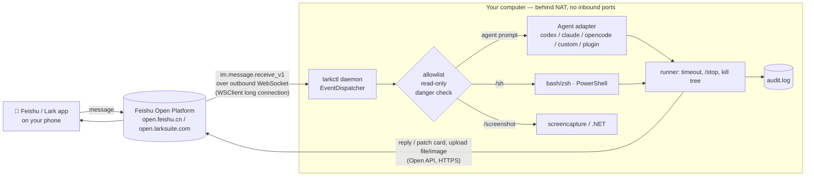

# larkctl

> Remote-control your computer — and the coding agents on it (Codex CLI, Claude Code, OpenCode, …) — from your phone, through a Feishu / Lark bot. No public IP, port forwarding, NAT traversal or VPN needed.

[中文文档](README.zh-CN.md) · v0.1 · MIT

## Why

Many developers (especially in mainland China) can't easily reach their home/office machine from a phone: no public IP, carrier-grade NAT, VPNs that are slow or blocked. Almost everyone has Feishu/Lark on their phone, though. Feishu's **long-connection event subscription** lets a program on your computer open an *outbound* WebSocket to Feishu and receive bot messages — so the computer never needs to be reachable.

`larkctl` is a small daemon that does exactly that: you DM your own bot "fix the failing test in project web", and it runs your local coding agent in that project, streams progress into an updating card, and replies with the result. Shell commands, screenshots, and control commands are also available, behind an allowlist and confirmation for dangerous commands.

## Quick start

```bash
npx larkctl init      # app id / secret, feishu or lark, allowlist, default agent & dir
npx larkctl start     # connect and serve (Ctrl-C to quit)
```

Then in Feishu, DM the bot:

```
/whoami                        → shows your open_id (add it to the allowlist via `larkctl init`)
/cwd web                       → switch to project "web" (config.projects) or any path
fix the flaky test in api.ts   → plain text = prompt for the current agent (session continues)
/agent claude                  → switch agent (codex | claude | opencode | custom | plugins)
/new                           → start a fresh agent session
!git status                    → shell (/sh also works)
/stop  /status  /screenshot  /help
```

Try it without Feishu at all: `npx larkctl start --mock` — stdin lines become chat messages, replies print to the terminal (see [docs/evidence/mock-session.txt](docs/evidence/mock-session.txt)).

Requirements: Node.js ≥ 18.17; the agent CLIs you want (`codex`, `claude`, `opencode`) installed and logged in on that machine.

## Architecture



## Commands

| Command | What |
|---|---|
| *plain text* | Prompt the current coding agent in the current dir. Session id is remembered per chat+agent and continued next time. |
| `/agent [name] [prompt]` | Show/switch agent; optionally send a prompt right away. `/agents` lists all. |
| `/new [prompt]` | Forget the agent session (fresh conversation). |
| `/cwd <project\|path>` (alias `/cd`, `/project`) | Change working dir (resets sessions). `/projects` lists shortcuts from config. `/pwd` shows it. |
| `/sh <cmd>` or `!<cmd>` | Run in bash/zsh (`$SHELL -lc`) on macOS/Linux, PowerShell on Windows. |
| `confirm <code>` | Run a pending dangerous command. |
| `/stop` | Kill the running job (whole process tree). |
| `/status` | Agent, session, cwd, running job. |
| `/screenshot` | Capture the screen and send as image (macOS `screencapture`, Windows .NET, Linux gnome-screenshot/scrot/import). |
| `/whoami` | Your open_id and chat_id — works for anyone, for setup. |

One job runs per chat at a time; others get "Busy". Agent progress: one card is sent and **patched** every `progressIntervalSec` with recent tool calls / commands and the latest assistant text, then finalised with the answer. Output longer than `maxReplyChars` is truncated (head + tail) in the card and the full text attached as a file.

## Coding agents

| Agent | Invocation | Resume |
|---|---|---|
| `codex` | `codex exec --json --skip-git-repo-check --cd <dir> -` (prompt on stdin) | `codex exec resume --json … <thread_id> -` |
| `claude` | `claude -p --output-format stream-json --verbose` (prompt on stdin) | `--resume <session_id>` |
| `opencode` | `opencode run --format json <prompt>` | `--session <sessionID>` |

These are non-interactive modes, so the agent can't ask you for permission mid-run. Give each agent the autonomy level you are comfortable with via `agentArgs`, e.g.:

```json
"agentArgs": {
  "codex": ["--full-auto"],
  "claude": ["--permission-mode", "acceptEdits", "--allowedTools", "Bash(npm test:*) Edit Read"]
}
```

### Custom command agents (config only)

```json
"customAgents": {
  "aider": { "command": "aider", "args": ["--message", "{prompt}", "--yes-always"] },
  "gemini": { "command": "gemini", "args": ["-p"], "promptViaStdin": true },
  "mycodex": { "command": "codex", "args": ["exec", "--json", "-"], "promptViaStdin": true, "parser": "codex" }
}
```

Placeholders `{prompt}`, `{cwd}`, `{session}`; `resumeArgs` are appended when a session id exists; `parser` reuses a built-in output parser (`text` default, `codex`, `claude`, `opencode`). Args are passed without a shell, so prompts are not shell-interpreted.

### Writing an adapter plugin

A plugin is an ES module (local file or npm package) exporting an `AgentAdapter` (as `default` or `adapters`), an array of them, or a factory `({ config }) => adapter | adapter[]`:

```ts
import type { AgentAdapter } from 'larkctl';

const adapter: AgentAdapter = {
  name: 'aider',                       // used by /agent aider
  description: 'Aider',
  // Pure function: build the process. larkctl spawns it in opts.cwd, handles
  // timeout, /stop (kills the tree), progress cards and the final reply.
  buildInvocation({ prompt, cwd, sessionId, extraArgs = [] }) {
    return { command: 'aider', args: ['--message', prompt, '--yes-always', ...extraArgs] /*, stdin, env */ };
  },
  // Optional: turn each stdout/stderr line into events.
  //   { type: 'session', id }  -> remembered and passed back as sessionId next time
  //   { type: 'text', text }   -> part of the final answer
  //   { type: 'progress', text } -> shown in the live progress card
  //   { type: 'error', text }
  parseLine(line) { return line.trim() ? [{ type: 'text', text: line }] : []; },
  // Optional: compute the answer from raw output if no text events were produced.
  finalize(raw) { return raw.slice(-2000); },
};
export default adapter;
```

Register it in `config.json`: `"plugins": ["./my-adapter.mjs", "larkctl-adapter-foo"]`. Relative paths and package names resolve from the config directory (install npm plugins there, e.g. `cd "<config dir>" && npm i larkctl-adapter-foo`). Load errors are shown in `/agents` and the log, never crash the daemon. See [examples/aider-adapter.mjs](examples/aider-adapter.mjs).

## Create the Feishu / Lark app

1. Open the developer console: **https://open.feishu.cn/app** (Feishu) or **https://open.larksuite.com/app** (Lark) → **Create Custom App** (企业自建应用). Name/icon anything.
2. **Credentials & Basic Info**: copy **App ID** (`cli_…`) and **App Secret**.
3. **Add features → Bot**: enable the bot capability.
4. **Permissions & Scopes** → add (tenant scopes):
   - `im:message.p2p_msg:readonly` — receive direct messages sent to the bot
   - `im:message.group_at_msg:readonly` — receive group messages that @mention the bot (only needed for groups)
   - `im:message:send_as_bot` — send messages as the bot
   - `im:message` — read/send messages; needed for replying to and **updating (patching) card messages**
   - `im:resource` — upload images/files (screenshots, long output)
   (Batch import: `{"scopes":{"tenant":["im:message","im:message:send_as_bot","im:message.p2p_msg:readonly","im:message.group_at_msg:readonly","im:resource"]}}`)
5. Run `npx larkctl init` then `npx larkctl start` on your computer **first** — the console checks for a live connection when you pick long-connection mode.
6. **Events & Callbacks → Event configuration**: subscription mode **"Receive events through persistent connection" / 使用长连接接收事件**, save; **Add event** → `im.message.receive_v1` (Receive message v2.0).
7. **Version Management & Release** → create a version, set availability to yourself, submit/publish (in your own tenant, an admin approval may be needed; changes to scopes/events only take effect after publishing a new version).
8. Find the bot in Feishu (search its name), DM `/whoami`, put your `open_id` into the allowlist (`npx larkctl init` again), restart.
9. Groups (optional): add the bot to a group, @-mention it with `/whoami` to get the `chat_id`, add it to `allowChats`. In groups only @-mentions reach the bot, and the sender must still be in `allowUsers` (unless `allowAnyUserInAllowedChats`).

For Lark (larksuite.com) choose `lark` as domain in `init`.

## Configuration

`npx larkctl init` writes `config.json` (file mode 600) in:
- macOS `~/Library/Application Support/larkctl/` · Windows `%APPDATA%\larkctl\` · Linux `$XDG_CONFIG_HOME/larkctl/` (override: `LARKCTL_CONFIG_DIR`). `LARKCTL_APP_SECRET` env overrides the stored secret.

Other keys: `allowUsers`, `allowChats`, `allowAnyUserInAllowedChats` (false), `replyToStrangers` (false = silence), `readOnly` (false), `commandTimeoutSec` (120), `agentTimeoutSec` (1800), `maxReplyChars` (3500), `defaultAgent`, `defaultCwd`, `projects` (`{"web": "/Users/me/code/web"}`), `customAgents`, `plugins`, `agentArgs`, `extraDangerousPatterns` (regex strings), `progressIntervalSec` (5). The same dir holds `audit.log` (JSONL), `state.json` (per-chat cwd/agent/session) and daemon logs. `npx larkctl config` prints the config with the secret redacted.

## Run in the background

- `npx larkctl start --daemon` / `npx larkctl stop` — simple detached process (logs to `larkctl.log` in the config dir).
- macOS launchd: [docs/service/com.larkctl.plist](docs/service/com.larkctl.plist)
- Linux systemd user unit: [docs/service/larkctl.service](docs/service/larkctl.service)
- Windows Task Scheduler / NSSM: [docs/service/windows.md](docs/service/windows.md)

Run it as **your user** (LaunchAgent / logon task), so agents find their logins and screenshots can see your desktop. Use `npm i -g larkctl` for a pinned version instead of `npx -y` in services if you prefer.

## Security

This is remote code execution on your computer by design. Read before using:

- **Deny by default.** Only `open_id`s in `allowUsers` are served (and in groups, only chats in `allowChats`). Others get silence (or a refusal if `replyToStrangers`). Only `/whoami` answers anyone, and it only reveals the sender's own ids. Messages sent by apps/bots are ignored.
- **Your Feishu account is the key.** Anyone who can send messages as you (unlocked phone, hijacked account) controls your computer. Keep the App Secret private; it is stored with mode 600 and never logged (`config` redacts it). Restrict app availability to yourself when publishing.
- **Dangerous commands** (`rm -r`, `sudo`, `mkfs`, `dd of=`, `shutdown/reboot`, `format C:`, `del /s`, `rd /s`, `Remove-Item -Recurse`, `diskpart`, `git push --force`, `git reset --hard`, `curl | sh`, fork bomb, `reg delete`, … see `src/security.ts`) need `confirm <code>` from the same user within 2 minutes. This is a speed bump against typos, **not a sandbox** — obfuscated commands will get through.
- **Coding agents are not covered by the dangerous-command filter**; they run with whatever autonomy flags you give them. Prefer the agents' own sandbox/permission modes.
- **Read-only mode** blocks agents and allows only a small set of inspection commands (`ls`, `cat`, `git status/log/diff`, …) without pipes/redirection.
- **Timeouts** for every command and agent run; `/stop` kills the whole process tree.
- **Audit log**: every accepted/denied request, confirmation and result code is appended to `audit.log`.
- Duplicated event deliveries are de-duplicated by message id.

## Limitations (v0.1)

- Verified locally with the SDK's `EventDispatcher` and a mocked client, plus `--mock` mode; not yet exercised against a live tenant by the author's CI.
- Agent output formats (Codex `--json`, Claude `stream-json`, OpenCode `--format json`) change between versions; parsers are best-effort and fall back to raw output.
- Non-interactive agents can't ask for approval mid-run; there is no interactive TTY/tmux mode (see prior art below if you need that).
- Only text and post messages are understood (no images/files from you to the bot yet). One job per chat.
- Card markdown has size limits; very long answers are attached as files.
- Dangerous-command detection is pattern-based and bypassable.

## Prior art & references

- **Official Feishu/Lark CLI** — [`@larksuite/cli`](https://www.npmjs.com/package/@larksuite/cli) (`npx @larksuite/cli`): `lark-cli event subscribe` streams events over the same long connection, `lark-cli im +messages-reply` replies. Great for scripting; larkctl is a dedicated, allowlisted daemon on top of the Node SDK instead.
- **[lark-forward](https://github.com/violin0847/lark-forward)** — a bash script that uses lark-cli event subscription to paste Feishu messages into a tmux pane running a coding agent, which replies via lark-cli ([write-up](https://juejin.cn/post/7649611053488668712)). Inspired the "phone → agent" workflow; larkctl drives agents in non-interactive mode instead of tmux and works on Windows.
- Similar projects: [botmux](https://github.com/deepcoldy/botmux), [codelark](https://github.com/huiyeruzhou/codelark), [claude-lark-plugin](https://github.com/IS908/claude-lark-plugin).
- Feishu docs: [Receive message event `im.message.receive_v1`](https://open.feishu.cn/document/server-docs/im-v1/message/events/receive), [Node SDK `@larksuiteoapi/node-sdk`](https://github.com/larksuite/node-sdk) (`WSClient` + `EventDispatcher`).

## Development

```bash
npm ci && npm run lint && npm run typecheck && npm test
npm run build && node dist/cli.js start --mock
```

CI runs lint, typecheck, unit tests and a `--mock` smoke test on Ubuntu, macOS and Windows.
