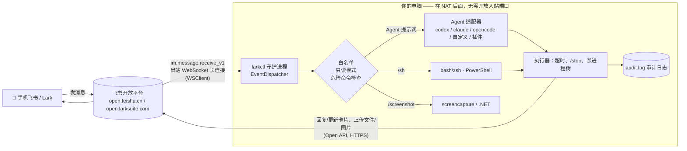

# larkctl

> 用手机上的飞书 / Lark 机器人远程控制你的电脑，以及电脑上的编程 Agent（Codex CLI、Claude Code、OpenCode……）。不需要公网 IP、端口映射、内网穿透或 VPN。

[English](README.md) · v0.1 · MIT

## 为什么

很多开发者（尤其在国内）没法方便地从手机访问家里/公司的电脑：没有公网 IP、运营商 NAT、VPN 慢或不可用。但几乎人人手机上都有飞书。飞书开放平台的 **长连接事件订阅** 让电脑上的程序主动向飞书建立 *出站* WebSocket 来接收机器人消息——电脑本身不需要被访问到。

`larkctl` 就是这样一个小守护进程：你私聊自己的机器人「修一下 web 项目里挂掉的测试」，它在该项目目录下调用本地编程 Agent，把进度实时更新到一张卡片里，完成后回复结果。也支持 Shell 命令、截图和控制命令，并有白名单和危险命令二次确认。

## 快速开始

```bash
npx larkctl init      # App ID / Secret、飞书或 Lark、白名单、默认 Agent 和目录
npx larkctl start     # 连接并开始服务（Ctrl-C 退出）
```

在飞书里私聊机器人：

```
/whoami                        → 显示你的 open_id（用 `larkctl init` 加入白名单）
/cwd web                       → 切换到项目 web（config.projects）或任意路径
修复 api.ts 里不稳定的测试      → 普通文本 = 发给当前 Agent 的提示词（自动续接会话）
/agent claude                  → 切换 Agent（codex | claude | opencode | 自定义 | 插件）
/new                           → 开新会话
!git status                    → Shell（也可用 /sh）
/stop  /status  /screenshot  /help
```

完全不用飞书也能试：`npx larkctl start --mock` —— 标准输入的每一行当作聊天消息，回复打印到终端（示例见 [docs/evidence/mock-session.txt](docs/evidence/mock-session.txt)）。

要求：Node.js ≥ 18.17；电脑上已安装并登录需要的 Agent CLI（`codex`、`claude`、`opencode`）。

## 架构



## 命令

| 命令 | 说明 |
|---|---|
| *普通文本* | 在当前目录把提示词发给当前 Agent。按「会话+Agent」记住 session id，下次自动续接。 |
| `/agent [名称] [提示词]` | 查看/切换 Agent，可直接带提示词。`/agents` 列出全部。 |
| `/new [提示词]` | 丢弃当前 Agent 会话，开新对话。 |
| `/cwd <项目名\|路径>`（别名 `/cd`、`/project`） | 切换工作目录（会重置会话）。`/projects` 列出配置里的项目快捷方式，`/pwd` 查看。 |
| `/sh <命令>` 或 `!<命令>` | macOS/Linux 用 bash/zsh（`$SHELL -lc`），Windows 用 PowerShell。 |
| `confirm <验证码>` | 执行待确认的危险命令。 |
| `/stop` | 终止正在运行的任务（整个进程树）。 |
| `/status` | 当前 Agent、会话、目录、运行中的任务。 |
| `/screenshot` | 截屏并以图片发回（macOS `screencapture`，Windows .NET，Linux gnome-screenshot/scrot/import）。 |
| `/menu`（或 `help`、`菜单`、任何未知命令） | **快捷选择卡片**：按钮切换 Agent（codex / claude / opencode / 自定义）、选择项目、新会话、停止、截图、状态，手机上不用打字。 |
| `截图` / `screenshot` | `/screenshot` 的自然语言快捷方式；`做得怎么样` / `进度` / `好了吗` → 状态卡片 + 截图（仅 ≤16 字的短消息触发）。 |
| `/whoami` | 显示你的 open_id 和 chat_id，任何人可用，用于初始配置。 |

每个会话同一时间只跑一个任务，其他请求会提示「Busy」。Agent 进度：先发一张卡片，每 `progressIntervalSec` 秒 **更新（patch）** 一次，显示最近的工具调用/命令和最新回答，结束时替换为最终结果。超过 `maxReplyChars` 的输出在卡片中截断（保留头尾），完整内容以文件形式发送。

### 手机友好：语音、图片、话题

- **语音 🎤**：在飞书里按住说话。机器人下载语音（`im.messageResource`），用 `ffmpeg` 转成 16k PCM，调用 **飞书语音识别**（`speech_to_text` 接口，需要权限 `speech_to_text:speech`），失败时回退到本地 **whisper**（whisper.cpp 的 `whisper-cli`、openai-whisper 的 `whisper`，或配置 `whisperCommand`）。识别结果会先回显（`🎤 …`），之后与文字消息完全相同处理（提示词、`/命令`、截图）。配置：`"asr": "auto" | "feishu" | "whisper" | "off"`。都不可用时会明确回复原因。
- **图片 🖼**：图片消息或富文本中的图片保存到 `<项目>/.larkctl/inbox/`，交给 Agent：Codex 使用 `--image=<文件>`，所有 Agent 的提示词里都会附上图片路径。单独发送的图片会暂存，附加到你的**下一条**消息。
- **回传图片**：`/screenshot`（或 📸 按钮、「截图」）通过 `im.image.create` 上传并回复到同一话题。Agent 回答中提到的、本次运行生成/修改的图片文件（如 `saved to chart.png`）最多回传 3 张（`"sendAgentImages": false` 关闭）。
- **话题（Thread）**：每个飞书话题拥有独立的 Agent、项目目录、会话和运行中的任务，多个话题可**并行**工作；回复发在话题内（`reply_in_thread`）。话题外的消息共用会话级状态。`/stop` 只停止当前话题的任务。绑定关系持久化在 `state.json`（键为 `chat_id#thread_id`）。新话题继承会话当前的 Agent 和项目。

## 编程 Agent

| Agent | 调用方式 | 续接 |
|---|---|---|
| `codex` | `codex exec --json --skip-git-repo-check --cd <dir> -`（提示词走 stdin） | `codex exec resume --json … <thread_id> -` |
| `claude` | `claude -p --output-format stream-json --verbose`（提示词走 stdin） | `--resume <session_id>` |
| `opencode` | `opencode run --format json <提示词>` | `--session <sessionID>` |

这些都是非交互模式，Agent 运行中无法向你申请权限。用 `agentArgs` 给每个 Agent 设定你能接受的自主程度：

```json
"agentArgs": {
  "codex": ["--full-auto"],
  "claude": ["--permission-mode", "acceptEdits"]
}
```

### 自定义命令 Agent（仅需配置）

```json
"customAgents": {
  "aider": { "command": "aider", "args": ["--message", "{prompt}", "--yes-always"] },
  "gemini": { "command": "gemini", "args": ["-p"], "promptViaStdin": true }
}
```

占位符 `{prompt}`、`{cwd}`、`{session}`；有 session 时追加 `resumeArgs`；`parser` 可复用内置输出解析器（默认 `text`，可选 `codex`/`claude`/`opencode`）。参数不经过 shell，提示词不会被 shell 解释。

### 编写 Agent 适配器插件

插件是一个 ES 模块（本地文件或 npm 包），导出一个 `AgentAdapter`（`default` 或 `adapters`）、适配器数组，或工厂函数 `({ config }) => adapter | adapter[]`：

```ts
import type { AgentAdapter } from 'larkctl';

const adapter: AgentAdapter = {
  name: 'aider',                       // /agent aider
  description: 'Aider',
  // 纯函数：构造进程调用。larkctl 负责在 opts.cwd 中启动、超时、/stop、进度卡片和最终回复
  buildInvocation({ prompt, cwd, sessionId, extraArgs = [] }) {
    return { command: 'aider', args: ['--message', prompt, '--yes-always', ...extraArgs] /*, stdin, env */ };
  },
  // 可选：把每行输出解析为事件
  //   { type: 'session', id }   -> 记住，下次作为 sessionId 传回
  //   { type: 'text', text }    -> 最终回答的一部分
  //   { type: 'progress', text } -> 显示在实时进度卡片中
  //   { type: 'error', text }
  parseLine(line) { return line.trim() ? [{ type: 'text', text: line }] : []; },
  // 可选：没有 text 事件时根据原始输出计算回答
  finalize(raw) { return raw.slice(-2000); },
};
export default adapter;
```

在 `config.json` 中注册：`"plugins": ["./my-adapter.mjs", "larkctl-adapter-foo"]`。相对路径和包名都相对配置目录解析（npm 插件装到配置目录：`cd "<配置目录>" && npm i larkctl-adapter-foo`）。加载失败会显示在 `/agents` 和日志中，不会让守护进程崩溃。示例：[examples/aider-adapter.mjs](examples/aider-adapter.mjs)。

## 创建飞书应用（分步）

1. 打开开发者后台 **https://open.feishu.cn/app**（Lark 为 https://open.larksuite.com/app）→ **创建企业自建应用**，名称图标随意。
2. **凭证与基础信息**：复制 **App ID**（`cli_…`）和 **App Secret**。
3. **添加应用能力 → 机器人**：开启机器人能力。
4. **权限管理** → 开通以下权限（可「批量导入」：`{"scopes":{"tenant":["im:message","im:message:send_as_bot","im:message.p2p_msg:readonly","im:message.group_at_msg:readonly","im:resource","speech_to_text:speech"]}}`）：
   - `im:message.p2p_msg:readonly` 读取用户发给机器人的单聊消息
   - `im:message.group_at_msg:readonly` 接收群聊中 @机器人 的消息（只在群里用时需要）
   - `im:message:send_as_bot` 以应用身份发消息
   - `im:message` 获取与发送单聊、群组消息（回复及 **更新卡片消息** 需要）
   - `im:resource` 获取与上传图片或文件资源（截图、长输出文件、下载你发的图片/语音）
   - `speech_to_text:speech` （可选）语音消息识别（飞书 ASR）
5. **先**在电脑上运行 `npx larkctl init` 和 `npx larkctl start` —— 后台选择长连接模式时会检测是否有在线连接。
6. **事件与回调 → 事件配置**：订阅方式选 **使用长连接接收事件**，保存；**添加事件** → `im.message.receive_v1`（接收消息 v2.0）。
   **回调配置** 页签：订阅方式同样选 **使用长连接接收回调**，**添加回调** → `card.action.trigger`（卡片回传交互）—— 快捷按钮需要它。
   可选：**机器人 → 自定义菜单**：可添加「发送文字消息」类型的菜单项，如 `/menu`、`/screenshot`、`/status`、`/stop`，larkctl 当作普通文字处理（无需订阅菜单事件）。
7. **版本管理与发布** → 创建版本，可用范围设为你自己，申请发布（企业内可能需要管理员审批；权限和事件的修改都要发布新版本后才生效）。
8. 在飞书里搜索机器人名字，私聊发送 `/whoami`，把 `open_id` 加入白名单（再次 `npx larkctl init`），重启。
9. 群聊（可选）：把机器人拉进群，@它发送 `/whoami` 得到 `chat_id`，加入 `allowChats`。群里只有 @机器人 的消息会送达，且发送者仍需在 `allowUsers` 中（除非开启 `allowAnyUserInAllowedChats`）。

国际版 Lark（larksuite.com）在 `init` 时选择 `lark` 域名。

## 配置

`npx larkctl init` 写入 `config.json`（文件权限 600）：
- macOS `~/Library/Application Support/larkctl/` · Windows `%APPDATA%\larkctl\` · Linux `$XDG_CONFIG_HOME/larkctl/`（可用 `LARKCTL_CONFIG_DIR` 覆盖）。环境变量 `LARKCTL_APP_SECRET` 可覆盖存储的 Secret。

其他配置项：`allowUsers`、`allowChats`、`allowAnyUserInAllowedChats`(false)、`replyToStrangers`(false=不回复)、`readOnly`(false)、`commandTimeoutSec`(120)、`agentTimeoutSec`(1800)、`maxReplyChars`(3500)、`defaultAgent`、`defaultCwd`、`projects`（`{"web": "/Users/me/code/web"}`）、`customAgents`、`plugins`、`agentArgs`、`extraDangerousPatterns`（正则字符串）、`progressIntervalSec`(5)。同目录下有 `audit.log`（JSONL 审计日志）、`state.json`（每个会话的目录/Agent/session）和守护进程日志。`npx larkctl config` 打印配置（Secret 已脱敏）。

## 后台运行

- `npx larkctl start --daemon` / `npx larkctl stop` —— 简单的后台进程（日志在配置目录 `larkctl.log`）。
- macOS launchd：[docs/service/com.larkctl.plist](docs/service/com.larkctl.plist)
- Linux systemd 用户服务：[docs/service/larkctl.service](docs/service/larkctl.service)
- Windows 任务计划程序 / NSSM：[docs/service/windows.md](docs/service/windows.md)

请以 **你自己的用户** 身份运行（LaunchAgent / 登录时启动的任务），这样 Agent 能找到登录态，截图也能看到桌面。

## 安全

这在设计上就是「远程在你电脑上执行代码」，使用前请阅读：

- **默认拒绝**：只服务 `allowUsers` 中的 open_id（群聊还需 chat 在 `allowChats` 中）。其他人收不到任何回复（或在 `replyToStrangers` 时收到拒绝）。只有 `/whoami` 对任何人响应，且只返回发送者自己的 id。机器人/应用发出的消息会被忽略。
- **你的飞书账号就是钥匙**：任何能以你身份发消息的人（未锁屏的手机、被盗账号）都能控制你的电脑。妥善保管 App Secret；它以 600 权限存储，从不写入日志。发布时把可用范围限制为你自己。
- **危险命令**（`rm -r`、`sudo`、`mkfs`、`dd of=`、`shutdown/reboot`、`format C:`、`del /s`、`rd /s`、`Remove-Item -Recurse`、`diskpart`、`git push --force`、`git reset --hard`、`curl | sh`、fork 炸弹、`reg delete` 等，见 `src/security.ts`）需要同一用户在 2 分钟内回复 `confirm <验证码>`。这只是防手滑的减速带，**不是沙箱**，混淆过的命令可以绕过。
- **编程 Agent 不受危险命令过滤**，它们按你给的自主参数运行。请优先使用 Agent 自带的沙箱/权限模式。
- **只读模式** 禁用 Agent，仅允许少量查看类命令（`ls`、`cat`、`git status/log/diff` 等），且不允许管道/重定向。
- 所有命令和 Agent 运行都有 **超时**；`/stop` 会杀掉整个进程树。
- **审计日志**：每次接受/拒绝的请求、确认和结果都追加到 `audit.log`。
- 飞书重复投递的事件按 message_id 去重。

## 限制（v0.1）

- 已用 SDK 的 `EventDispatcher` + 模拟客户端和 `--mock` 模式本地验证；尚未在 CI 中连接真实租户。
- Agent 输出格式（Codex `--json`、Claude `stream-json`、OpenCode `--format json`）会随版本变化，解析为尽力而为，失败时回退为原始输出。
- 非交互 Agent 运行中无法向你申请审批；暂无交互式 TTY/tmux 模式（需要的话参考下方同类项目）。
- 支持文本、富文本、图片和语音消息；其他文件暂不支持。每个会话/话题同时只运行一个任务。
- 飞书语音识别单段最长约 60 秒。
- 卡片 Markdown 有长度限制，超长回答以文件发送。
- 危险命令检测基于正则，可被绕过。

## 参考与同类项目

- **飞书官方 CLI** —— [`@larksuite/cli`](https://www.npmjs.com/package/@larksuite/cli)（`npx @larksuite/cli`）：`lark-cli event subscribe` 通过同样的长连接接收事件，`lark-cli im +messages-reply` 回复消息。适合脚本化；larkctl 则是基于 Node SDK、带白名单的专用守护进程。
- **[lark-forward](https://github.com/violin0847/lark-forward)** —— 一个 bash 脚本，用 lark-cli 事件订阅把飞书消息粘贴到运行编程 Agent 的 tmux pane 中，Agent 再通过 lark-cli 回复（[介绍文章](https://juejin.cn/post/7649611053488668712)）。启发了「手机 → Agent」的工作流；larkctl 改用非交互模式驱动 Agent，不依赖 tmux，并支持 Windows。
- 同类项目：[botmux](https://github.com/deepcoldy/botmux)、[codelark](https://github.com/huiyeruzhou/codelark)、[claude-lark-plugin](https://github.com/IS908/claude-lark-plugin)。
- 飞书文档：[接收消息事件 `im.message.receive_v1`](https://open.feishu.cn/document/server-docs/im-v1/message/events/receive)、[Node SDK `@larksuiteoapi/node-sdk`](https://github.com/larksuite/node-sdk)（`WSClient` + `EventDispatcher`）。

## 开发

```bash
npm ci && npm run lint && npm run typecheck && npm test
npm run build && node dist/cli.js start --mock
```

CI 在 Ubuntu、macOS、Windows 上运行 lint、类型检查、单元测试和 `--mock` 冒烟测试。
